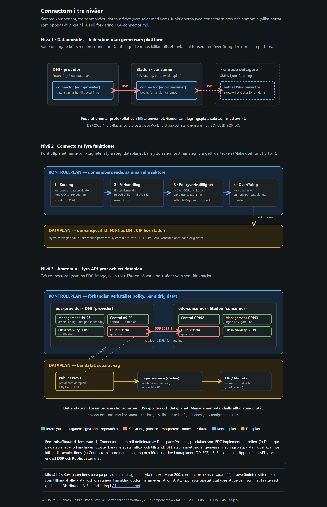

# 5. Dataområdet: connectorn, policyerna och KoV-gaten (steg 5–7)

Det här kapitlet förklarar kontrollplanet – den del av kedjan som gör
PoC:en till en dataspace-implementation i stället för en vanlig
integration.

## 5.1 Vad en connector är

EU:s datastrategi bygger dataområden (data spaces): federationer där
organisationer delar data och behåller rådigheten över dem. Ett
dataområde saknar gemensam dataplattform. Datat ligger kvar hos den som
tillhandahåller det, tills ett maskinellt förhandlat avtal auktoriserar
en överföring direkt mellan parterna.

Connectorn är den programvara varje deltagare kör för att vara med. Den
är deltagarens tekniska ombud utåt: den visar upp organisationens
erbjudanden, förhandlar villkor med motpartens connector och släpper
igenom en överföring först när avtalet finns. Själva datat tar en annan
väg, dataplanet, och passerar aldrig förhandlingen.

**Protokollet definierar connectorn.** Dataspace Protocol (DSP)
specificerar exakt vad två connectorer säger till varandra: hur en
katalog begärs och besvaras (med W3C:s katalogvokabulär DCAT), hur
villkor uttrycks (ODRL), hur kontraktsförhandlingens tillståndsmaskin
fortskrider och hur en överföring koordineras. Version 2025-1 är den
första officiella utgåvan, förvaltad av Eclipse Dataspace Working Group
och inlämnad till ISO/IEC som DIS 26450. Systerprotokollet Decentralized
Claims Protocol (DCP) standardiseras samma väg och täcker
identitetsdelen. Connectorn är därmed en **roll definierad av ett
protokoll** – jämför med "webbserver". PoC:en använder Eclipse EDC
0.17.0, referensimplementationen flest EU-initiativ bygger på; §6.1 drar
konsekvensen att arkitekturens åtagande ligger på protokollnivå, och
varje komponent som talar DSP kan ersätta EDC.

Fem vanliga missförstånd, med det korta svaret: *"Connectorn är en
produkt man köper"* – den är en roll; provider och consumer kör i PoC:en
samma image med olika konfigurationsfil. *"Datat går genom
förhandlingen"* – kontrollplanet utbyter metadata, villkor och tillstånd;
nyttolasten går på dataplanet. *"Dataområdet har en gemensam plattform"*
– federationen består av protokollet och tillitsramverket, en gemensam
lagringsplats saknas med avsikt. *"Connectorn lagrar och förädlar data"*
– den koordinerar; lagring och tillgängliggörande hör hemma i dataplanet
(CIP hos staden, Future City Flow hos leverantören). *"En connector är en
tjänst med ett API"* – den öppnar flera API-ytor med olika publik, och
det är driftsättningens kärnfråga:



| Yta | Provider-port | Vem talar hit | Korsar org-gränsen? |
|---|---|---|---|
| Management | 19193 | Deltagarens egna appar och operatörer; här sitter KoV-godkännandet | Nej – internt |
| DSP/protocol | 19194 | Motpartens connector | **Ja – enda kontrollplansytan som korsar** |
| Control | 19192 | Connectorns egna komponenter | Nej – internt |
| Observability | 19191 | Health och driftmetrik | Nej – internt |

Därtill dataplanets publika kontext (19291) – den enda väg datat tar.
Consumern speglar samma ytor på 291xx. **Management-ytan hålls alltid
stängd utåt:** att öppna 19193 mot omvärlden vore att ge vem som helst
rätten att godkänna Distribution A.

## 5.2 DSP-katalogen och ODRL-policyerna

**Arkitekturkravet** (§6.3): användningsvillkoren uttrycks som
ODRL-policyer knutna till varje distribution – tillåtelser, förbud och
skyldigheter. Policyn följer med i katalogens erbjudande, blir del av det
förhandlade avtalet och verkställs automatiskt av kontrollplanet vid
varje transaktion.

**Hur PoC:en gör.** Providern registreras med asset + policy +
kontraktsdefinition **per distribution** – A och B har varsin, aldrig
delade (`edc/bootstrap/registrera.py`, idempotent). Assets pekar med
`HttpData`-adress på fcf-sims `/distributions/{a,b}/latest`. Consumern
hämtar katalogen genom att POST:a mot providerns DSP-adress; svaret är en
`dcat:Catalog` där varje dataset bär `odrl:hasPolicy` med ett
förhandlingsbart offert-id.

* **B** (`policy-distribution-b.json`): permission `use` (med duty
  `attribute`), `distribute`, `publish`. Tomma prohibition/obligation.
* **A** (`policy-distribution-a.json`): permission `use` **med
  constrainten** `svada:deltagare eq "stad"`; prohibition
  `distribute`/`publish`; obligation `svada:kovGodkannande`.

Så här ser A:s offert ut i katalogen – de tre delarna syns direkt:

```json
{ "@type": "Offer",
  "permission":  [ { "action": "use",
                     "constraint": [ { "leftOperand": "https://svada.goteborg.se/ns/deltagare",
                                       "operator": "eq", "rightOperand": "stad" } ] } ],
  "prohibition": [ { "action": "odrl:distribute" }, { "action": "odrl:publish" } ],
  "obligation":  [ { "action": "https://svada.goteborg.se/ns/kovGodkannande" } ] }
```

SVADA:s egna ODRL-termer (`svada:deltagare`, `svada:kovGodkannande`)
definieras i en egen namnrymd och binds i EDC-runtimen
(`SvadaOdrlExtension.java`). `svada:deltagare` får en
utvärderingsfunktion registrerad enbart i förhandlingsscopet
(`DeltagareFunktion.java`) – utvärderas när consumern skickar sin
kontraktsbegäran, och fel deltagare ger `TERMINATED` direkt. Providerns
logg visar utvärderingen:
`SVADA ODRL utvärderad: svada:deltagare EQ 'stad' mot deltagare 'stad' => true`.

Två gotchor för den som förhandlar via API: policyn i
`ContractRequest` måste vara **hela offerten ur katalogen** plus
`assigner` och `target` – med bara offertens `@id` terminerar consumern
förhandlingen med "Policy in the contract agreement is not equal…". Och
offert-id:t är base64-kodat och **ändras vid varje omregistrering** –
hämta det alltid ur katalogen strax före förhandlingen.

## 5.3 KoV-gaten: provider-sidig policyverkställighet

**Arkitekturkravet** (§6.2): "Den tillhandahållande partens kontrollplan
äger policyverkställigheten. Kontraktsförhandlingen för en
behörighetsstyrd distribution stannar därför hos tillhandahållaren tills
dataägarens godkännande har registrerats där. Konsumenten kan aldrig
ensidigt finalisera sin egen åtkomst." Projektets regel:
KoV-godkännandet implementeras på **provider-sidan** – aldrig på
consumer-sidan. Kravet gäller alltså *var* beslutet verkställs, och en
lösning som lät consumern finalisera sig själv efter ett godkännande
någon annanstans skulle bryta invarianten även om den formellt "krävde
godkännande".

**Hur PoC:en gör.** Eclipse EDC har en förlängningspunkt för exakt detta:
`ContractNegotiationPendingGuard`. Providerns statsmaskin kör guarden
före varje processteg i en förhandling. Returnerar guarden `true` sätts
`pending = true` och posten ligger kvar i `REQUESTED` tills någon sätter
tillbaka `pending = false`. Det *är* "förhandlingen pausar hos DHI:s
connector". Tre designval bär lösningen:

1. **Utlösaren är ODRL-policyn, aldrig ett asset-id.** Gaten biter på en
   förhandling vars offert bär obligationen `svada:kovGodkannande`.
   Policyn deklarerar kravet; gaten verkställer det. Registreras fler
   K1-produkter behöver gatens kod ingen ändring.
2. **Samma image, olika roll via konfiguration.** Gaten och dess
   `/kov`-endpoints aktiveras bara av `svada.kov.gate.enabled=true`, som
   enbart står i `edc/konfig/provider.properties`. Consumern har därför
   ingen `/kov`-endpoint alls – det finns ingen bakväg.
3. **Gaten biter bara i `REQUESTED` och på provider-sidan.** Andra
   tillstånd släpps igenom, annars skulle även ett avslag (som går via
   `TERMINATING`) fastna.

Två alternativ valdes bort: en ODRL-constraint som returnerar `false`
(ger `TERMINATED` direkt – fel semantik, beslutet ska *vänta*) och en
proxy framför management-API:t (hade legat utanför connectorn och pausat
ingenting). Koden bor i `edc/src/main/java/se/goteborg/svada/edc/kov/`:
`KovGate` (guarden och besluten), `KovController` (management-API:t:
`GET /forhandlingar`, `POST /forhandlingar/{id}/godkann` respektive
`/avsla`), `KovGateExtension` (kopplar in båda när flaggan är på).

Så här ser en väntande A-förhandling ut i providerns kö:

```json
{ "assetId": "modellerad-bradddata-a", "counterPartyId": "stad",
  "state": "REQUESTED", "pending": true,
  "kraverKovGodkannande": true, "kovBeslut": "VANTANDE" }
```

Efter `POST …/godkann` fortsätter förhandlingen från exakt det tillstånd
den låg i och når `FINALIZED`. Efter `…/avsla` blir den `TERMINATED` med
skälet "KoV (Kretslopp och Vatten) avslog begäran om Distribution A
(K1R1T1, non-public)" – avslagsskälet följer med i DSP-terminationen och
är spårbart på båda sidor.

**Bevis** (`tests/verify_ap4b.sh`): A står kvar i `REQUESTED` med
`pending=true` efter 30 sekunder, utan avtal (4b.2); godkännande ger
`FINALIZED` (4b.3); **samma anrop mot consumerns port 29193 ger HTTP
404** (4b.4 – ingen bakväg); avslag ger `TERMINATED` med skäl (4b.5).
Hela suveränitetspoängen ryms i två anrop:

```bash
curl -s -o /dev/null -w '%{http_code}\n' localhost:39193/management/kov/forhandlingar  # 200
curl -s -o /dev/null -w '%{http_code}\n' localhost:39393/management/kov/forhandlingar  # 404
```

Varför sitter grinden hos DHI och inte hos staden? Därför att Dataspace
Protocol lägger policyverkställigheten hos den som lämnar ut. En grind
hos mottagaren kan mottagaren öppna själv.

## 5.4 Transfer och ingest-validering

**Arkitekturkravet** (§4.3 steg 5): överföringen auktoriseras av
kontrollplanet, loggas och valideras vid mottagning; för den öppna
distributionen verifieras att positionsuppgifter för brunnar saknas. Data
som bryter mot avtalade villkor avvisas.

**Hur PoC:en gör.** Transfern är **HttpData-PUSH**: consumern begär en
transfer med en destination som pekar på ingest med en Bearer-token;
providerns dataplan hämtar ur fcf-sim och pushar nyttolasten till
`ingest-service`. Ingest kör tre led före någon skrivning:

1. **Auktorisation.** `contractAgreementId` växlas mot en **engångstoken**
   (TTL 600 sekunder) via `/auktorisation`, som slår upp avtalet i
   *stadens* EDC. Saknad token ger 401; okänd, förbrukad eller utgången
   ger 403.
2. **Kuvert- och avtalsvalidering.** Obligatoriska fält kontrolleras och
   distributionen matchas mot avtalet – ett B-avtal som bär A-innehåll
   ger 409.
3. **Postvalidering.** Schemat kontrolleras, och för B att
   `location`/`sourceSrs` **saknas**. Finns de – felinjektionen `gis_i_b`
   – avvisas **hela leveransen** med orsaken
   `brunns-gis-i-distribution-b`, och avvisningen slår igenom till EDC
   som `TERMINATED`.

Poängen: nyttolasten bär ingen flagga om att den är fel. Mottagaren
upptäcker det själv – den kontrollerar i stället för att lita på
avsändaren.

**Bevis** (`tests/verify_ap4c.sh`): E2E för B (förhandling → transfer →
91 entiteter i CIP); transfer utan avtal avvisas (utan token 401,
påhittad token 403, återanvänd engångstoken 403 – och ingenting skrevs);
felinjektionen fångas med spårbar orsak medan CIP:en är opåverkad. Kör
själv:

```bash
curl -s -o /dev/null -w '%{http_code}\n' -X POST localhost:38060/ingest \
  -H 'Content-Type: application/json' -d '{}'     # 401 – ingen auktorisation
curl -s localhost:38060/leveranser | jq '.counters'
```

**Känd svaghet:** EDC:s deprecerade inbäddade dataplan kan kasta
`IOException: closed` vid tät transferstart. Kontrollrummet väntar på
ingest-kvittot och gör om upp till tre gånger med 20 sekunders andrum;
ett fristående dataplan är en produktionsuppgift. Notera också att
`fcf-sim` publicerar port 8050 på värden enbart för demons och
verifieringens skull – i skarp drift publiceras dataplanet inte alls, och
det som skyddar Distribution A är kontraktsledet.

## 5.5 Styrning: var besluten fattas

PoC:en är teknisk, men varje steg bygger på beslut som någon måste ha fattat. DSSC Blueprint
v3.0 delar styrningen i tre lager: **dataspace** (gemensamma spelregler), **deltagare**
(varje organisations egna beslut) och **användningsfall** (regler för en viss dataprodukt).
Tabellen visar var PoC:en redan har styrning i kod, och vad som saknas. Samma text står som
raden *Styrning* i varje steg i kontrollrummet.

| Lager | Styrfråga | Var den syns i PoC:en | Vem som äger den i verkligheten |
|---|---|---|---|
| Dataspace | Vem får vara med? | Svadas utfärdare utfärdar medlems- och deltagarintyg (steg 3) | Data Space Governance Authority (målarkitekturens bilaga 2: SVADA:s styrning, eskalering till Intraservice) |
| Dataspace | Vilka intyg godtas av vem? | `supportedtypes`: varje intygstyp godtas bara från rätt utfärdare | Regelboken (rulebook); saknas (G15) |
| Dataspace | Vilka standarder gäller? | DSP, ODRL, verifierbara intyg är fasta i koden (steg 2) | Regelboken |
| Dataspace | Hur stängs en part ute? | Samordnaren återkallar medlemsintyget (statuslista, steg 3 i kontrollrummet); ingen process kring det | Governance Authority |
| Deltagare | Vem hos oss får besluta? | Rollintyget: staden intygar KoV:s roll, DHI sin egen | Respektive organisation |
| Användningsfall | Får A lämnas ut, och till vem? | KoV-spärren på providern (steg 3) | Dataägaren (KoV) |
| Användningsfall | Får ett gällande avtal upphöra? | Hävningen: KoV-knappen, avslag av en ny begäran | Dataägaren |
| Användningsfall | Vilken klass har datat? | K1R1T1 (A) och K0R1T1 (B) i produkten (steg 1) | Dataägaren och datastewarden |
| Användningsfall | Vilken kvalitet utlovas? | Ingen kvalitetsdeklaration (G2) | Datastewarden |

Den enda plats där styrning på dataspacets nivå har blivit kod är Svadas utfärdare, och den är
en medveten förenkling. Där en roll saknas är det inte en kodlucka utan ett organisatoriskt
beslut som ska fattas först (målarkitekturens bilaga 2).
