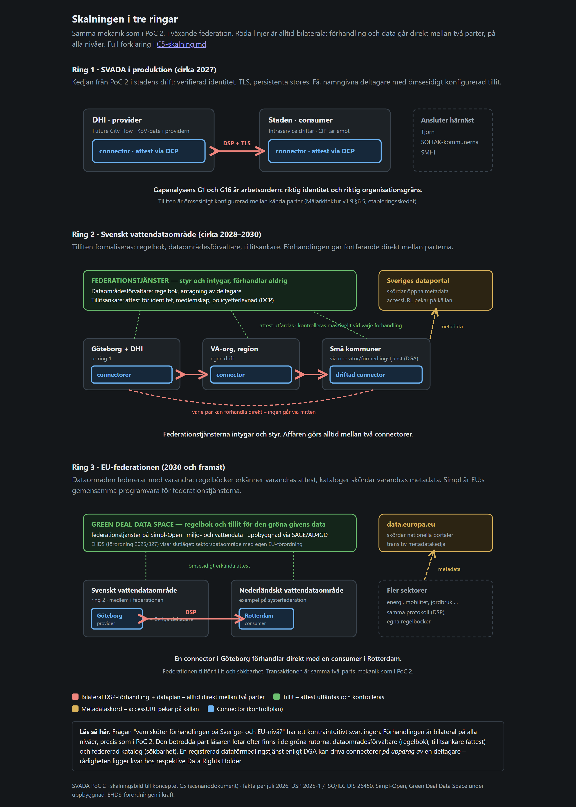

# 8. Det tvärgående: identitet, resursstrategi, drift och skalning

Fyra frågor som inte hör till något enskilt steg men som avgör hur
PoC:en ska läsas: vem är det egentligen som agerar (identiteten)? varför
ser designvalen ut som de gör (resursstrategin)? vad händer när något går
sönder och hur mycket data blir det (driften)? och hur ser samma mönster
ut när dataområdet växer (skalningen)?

## 8.1 Identiteten: mockad → verifierbar attest

**Arkitekturkravet** (§6.5): deltagaridentitet och behörigheter uttrycks
som verifierbara attest (W3C Verifiable Credentials), utfärdade inom
tillitsramverket och kontrollerade maskinellt vid katalogåtkomst,
förhandling och överföring. Minst tre attesttyper förutses: identitet,
medlemskap i dataområdet och efterlevnad av specifika policyer. §3.4
kräver att dataägarbeslutet fattas av en namngiven roll.

**Så här löste PoC:en det till och med 2026-08-30.** EDC drog in modulen
`iam-mock`, som utfärdade och godtog tokens utan verifiering. Deltagar-id
var strängarna `dhi` och `stad`, självdeklarerade i konfigurationen, och
management-API:erna gick helt utan autentisering. Konsekvenserna var två,
och båda var verkliga:

1. ODRL-constrainten `svada:deltagare eq "stad"` – hela A-policyns
   åtkomstbegränsning – utvärderades mot en identitet som motparten själv
   påstod.
2. KoV-godkännandet kunde utlösas av vem som helst som nådde port 19193.
   Beslutet var anonymt och kunde inte knytas till Data Rights
   Holder-rollen.

PoC:en bevisade alltså att beslutet verkställdes på rätt **plats**, men
inte att det fattades av rätt **part**. Det var gapanalysens enda
**kritiska** gap (G1).

**Så här ser det ut sedan nyckelskyddade management-API:er och verifierbar DCP-identitet (klart 2026-09-01).**
`iam-mock` – helt utbytt. Först stängdes management-API:erna bakom en
delad nyckel (`web.http.management.auth.type=tokenbased`). Sedan gick vi
längre och ersatte den påstådda identiteten med en verifierbar: EDC:s
egen DCP/IdentityHub utfärdar `did:web`-identiteter och ett
`SvadaRoleCredential` per deltagare (steg 2–5), och
`KovController.godkann()`/`avsla()` kräver numera ett kryptografiskt
verifierat sådant attest – inte bara management-nyckeln – innan ett
KoV-beslut accepteras (steg 6, `KovIdentitetsverifiering.java`).
Negativtestet i `tests/verify_ap8_fas2.sh` (testfall 8.1–8.3) bevisar att
katalog-, förhandlings- och överföringsanrop utan giltigt attest avvisas
med HTTP 401 (`DspRequestHandlerImpl`, EDC:s eget DSP-lager). Arbetet gjordes i sju steg, från
IdentityHub och `did:web`-identiteter till själva verifieringen och
transfer-proxyns nyckelpar.

**Migrationsanteckningar – vad som fortfarande skiljer det här från en
produktionsdriftsättning.** Mekanismen är äkta DCP, men sju avgränsningar
är medvetna och kvarstår:

1. **In-memory-stores.** Både EDC-connectorerna och IdentityHub kör utan
   `controlplane-feature-sql-bom` (se `edc/build.gradle.kts`). En omstart
   nollställer deltagarregistret, utfärdade attest och pågående
   förhandlingar. Produktion kräver persistenta (SQL-) stores.
2. **`did:web` pekar på interna Docker-värdnamn** (t.ex.
   `did:web:identity-hub-dhi%3A19197`), inte på en riktig, publikt DNS-satt
   domän med TLS. `did:web` KRÄVER att dokumentet går att hämta över HTTPS
   från den domän identiteten påstår – det är inte uppfyllt här.
3. **STS-klienthemligheter är statiska värden i `.env`**, inte en hanterad
   autentiseringslivscykel (rotation, återkallelse, utgång). Produktion
   behöver en riktig hemlighetshantering per deltagare.
4. **STS-porten (29199/19199) är medvetet inte publicerad mot host** – en
   PoC-avgränsning för att undvika ett anonymt kringgående av
   dataspace-gränsen från laptopens egna nätverk. Testerna hämtar tokenet
   via `docker exec` i en container som redan ligger på det interna nätet
   (`hamta_kov_token()`, `tests/lib.sh`). En riktig deltagare skulle nå STS
   via samma väg som sin egen connector gör, inte via ett testskript.
5. **`atkomst.py`/`auktorisation.py` fick medvetet INGEN egen
   VC-verifiering** (ett medvetet designbeslut).
   De litar transitivt på att ett registrerat avtal i stadens egen
   EDC-connector redan bevisar hela kedjan. Håller det antagandet, är
   arkitekturberoende: om gatewayen och EDC-connectorn någonsin separeras
   över en förtroendegräns behöver den bedömningen göras om.
6. **Testfall 8.4 (mock-markören `MEDVETEN FÖRENKLING` ska ge noll träffar
   i `edc/`) är UPPFYLLT.** Ett tidigare steg lämnade dataplanets separata
   transfer-proxy-token-signeringsnyckelpar hårdkodat, utanför den
   verifierbara DCP-identitetens omfattning - men ett senare fynd visade att gapet var mindre än
   väntat (den generiska EDC-modulen `data-plane-iam` läser redan
   nyckelmaterialet via vault-alias, aldrig hårdkodat i den generiska
   koden), så det stängdes i en egen, fristående commit EFTER att den
   verifierbara DCP-identiteten markerades klar: `SvadaTransferProxyNyckelExtension` genererar nu
   ett RSA-nyckelpar slumpmässigt vid varje uppstart, unikt per instans,
   i stället för det hårdkodade testnyckelparet. Se `tests/verify_ap8_fas2.sh`
   testfall 8f2.4.
7. **Ingen federation, en enda tillitsram.** Alla tre IdentityHub-instanser
   (Svadas utfärdare, DHI, Staden) körs i samma docker-compose-uppsättning.
   Sedan utfärdaren fick rätt mandat har den en egen hub (`compose.dsga.yml`, simulerad
   DSGA 0.1), men den är fortfarande en container bredvid de andra. En riktig flerorganisationsdataspace
   (separata organisationer med eget tillitsramverk, planerat) behöver ett faktiskt, delat tillitsramverk mellan skilda
   driftsorganisationer.
8. **Femminuters-cache i DID-resolvern** (`edc.did.resolver.cache.expiry`,
   default 5 minuter, `IdentityDidCoreExtension.java`/
   `DidResolverRegistryImpl`, modulen `identity-did-core`). EDC cachar
   upplösta DID-dokument – inklusive motpartens publika nyckel – i minnet.
   Om en IdentityHub-instans startas om ISOLERAT, utan att de containrar
   som litar på den startas om samtidigt, genererar den ett helt nytt
   nyckelpar (`SecureRandom`, `SvadaParticipantBootstrapExtension.java`),
   men de andra parterna fortsätter i upp till 5 minuter att verifiera mot
   det gamla, cachade DID-dokumentet. Symptomet är förvillande: "JWT
   signature not valid" på till synes friska anrop, inklusive den
   omstartade partens EGEN DSP-katalogtrafik – inte bara identiteter den
   just bytte.

   **Driftregel:** vänta minst 5 minuter efter en isolerad omstart av
   `identity-hub-dhi`/`identity-hub-stad` innan du felsöker vidare, eller
   starta om `edc-provider`/`edc-consumer` samtidigt (de har då ingen egen
   kvarvarande cache av motpartens gamla nyckel). Ett snabbt sätt att
   avgöra om felet ÄR cachen: om en verifieringssvit gick grönt precis
   före omstarten och nu visar "JWT signature not valid" på anrop som
   inte ens rör den omstartade instansen, är det nästan alltid den här
   fällan, inte en regression. Inte löst i kod – en riktig lösning skulle
   sänka `edc.did.resolver.cache.expiry` i PoC-konfigurationen eller lägga
   in ett uttryckligt väntesteg i drifthandledningen – kvar som en känd,
   dokumenterad operationell begränsning.

9. **Vault-partitionering vid hemlighetssådd – ett tyst 401 på all
   DSP-trafik (upptäckt och åtgärdat 2026-09-14).** EDC:s `InMemoryVault`
   stöder hemligheter partitionerade per deltagare
   (`resolveSecret(vaultPartition, key)`), med en enklare, parameterlös
   variant som faller tillbaka på partitionen `"default"` om ingen
   `ParticipantContext` är tillgänglig när anropet görs
   (`InMemoryVault.getPartition()`). `SvadaDcpIdentityExtension.java`
   sådde tidigare STS-klienthemligheten med just den parameterlösa
   varianten, väldigt tidigt i uppstarten – innan deltagarens egen
   `ParticipantContext` hunnit bli tillgänglig – vilket seedade
   hemligheten i `"default"`. EDC:s egen `RemoteSecureTokenService`, som
   bygger det faktiska OAuth2-anropet till STS:en inför varje DSP-anrop,
   slår i stället upp hemligheten EXPLICIT i deltagarens egen
   DID-partition. Facken matchade inte: `resolveSecret` returnerade
   `null`, och `RemoteSecureTokenService` gav `Result.failure()` DIREKT –
   utan att något nätverksanrop någonsin gjordes och utan en enda
   loggrad (varken INFO, WARNING eller ERROR).

   **Symptom:** identiskt `HTTP 401`/`502` (`CatalogError`,
   `"reason":["Unauthorized"]`) på ALLA anrop som kräver DCP-identitet –
   katalog, förhandling och transfer – med noll nätverkstrafik till
   STS:en eller motparten, oavsett hur länge man lyssnade.

   **Åtgärdat i den här leveransen** (commit `65fb877`): extensionen
   läser nu ut deltagarens eget `edc.participant.id` och seedar
   hemligheten EXPLICIT i den partitionen – samma partition som
   `RemoteSecureTokenService` senare slår upp i. Gäller båda sidor (DHI
   och Staden delar koden). `tests/verify_all.sh` är grönt igenom med
   fixen på plats.

   **Driftregel för vidareutveckling:** all ny kod som seedar hemligheter
   i EDC:s vault (ny identitetslogik, nya credential-typer, fler
   deltagare) måste använda den partitionerade
   `vault.storeSecret(participantId, key, value)` – ALDRIG den
   parameterlösa tvåargumentsvarianten – eftersom felet är helt tyst och
   inte visar sig förrän ett faktiskt DSP-anrop misslyckas, långt senare
   i kedjan.

10. **Startordningsberoende attestimport – ett tyst 401 efter varje
    samtidig omstart (upptäckt och åtgärdat 2026-10-06; sedan utfärdaren fick rätt mandat är
    det Svadas utfärdare, inte DHI, som skriver intygen).** Utfärdaren
    skriver DHI:s och Stadens attest som filer på den delade volymen
    `vc-utbyte`, avslutat med markörfilen `.klar`; Staden väntar på
    markören och läser in filerna. Volymen överlever omstarter, medan
    utfärdaren genererar ett NYTT nyckelpar vid varje start. Startar alla
    containrar samtidigt (omstart av Docker, `restart: unless-stopped`)
    ligger förra körningens markör kvar: uppmätt läste Staden in de
    gamla attesten 0,14 s innan utfärdaren hunnit skriva nya. De är signerade
    med en nyckel som inte längre finns.

    **Symptom:** kontrollrummet visar 13 av 13, alla containrar är
    `healthy`, men varje DSP-anrop ger `CatalogError 401` – utan en enda
    loggrad. (Det som tidigare antecknades som "tyst 401 efter ett dygns
    drift" var detta: båda stackarna hade startats om av Docker.)

    **Åtgärdat** (`SvadaParticipantBootstrapExtension.java`): DHI tar
    bort den gamla markören innan nya attest skrivs (det gör utfärdaren,
    Svada), och DHI och Staden godtar
    bara attest vars signatur går att verifiera mot nyckeln i
    utfärdarens AKTUELLA DID-dokument (hämtat direkt, utan resolverns
    cache enligt punkt 8) – annars väntar de, upp till 150 sekunder, och
    loggar skälet. Testfall 8.7 (`verify_ap8_fas2.sh`, 8f2.7) startar om
    alla tre IdentityHub och båda connectorerna samtidigt och kräver att
    katalogen svarar.

    **Kvar:** (a) startas Svadas utfärdare om ENSAM behåller DHI och Staden
    attest signerade med den gamla nyckeln tills Staden också startas om
    – en riktig lösning är beständiga nycklar eller ett
    förnyelse-/återutfärdandeflöde; (b) connectorernas registreringar
    (assets, policyer, kontraktsdefinitioner) ligger i minnet och kräver
    `registrera-edc` efter varje omstart av providern. Därför startar
    ingenting automatiskt lokalt (`SVADA_RESTART=no`), och på servern kör
    `svada-aterstall.service` en full återställning efter varje
    Docker-start.

    **Lärdom för en riktig dataspace:** två organisationer kan inte
    styra i vilken ordning deras tjänster startar. Ett utbyte av attest
    får aldrig bero på "den andra är redan uppe" – mottagaren måste
    kontrollera attesten mot utfärdarens aktuella nyckel.

11. **Utfärdare med rätt mandat.** Svadas utfärdare
    (`identity-hub-svada`, `compose.dsga.yml`) utfärdar medlems- och
    deltagarintyg åt DHI och Staden; rollintyg utfärdar organisationen
    själv. Verifieringen godtar varje intygstyp bara från rätt utfärdare
    (`edc.iam.trustedissuer.*.supportedtypes`). Startordning: svada, dhi, stad
    (`starta-demo.sh` väntar tills utfärdaren är frisk). Utfärdarens volym är
    rw hos utfärdaren och ro hos de andra. **MEDVETEN FÖRENKLING:** simulerar
    DSGA 0.1:s tillitstjänst; inga intyg är förankrade i eIDAS; ingen
    återkallelse. Se `docs/koncept/C1-identitet.md` "Utfärdarmodellen".

## 8.2 Resursstrategin: därför ser designvalen ut som de gör

Hela kedjan – ett dussin containrar, flera JVM:er, två MongoDB-instanser –
ska rymmas på en laptop utan att OOM-killern slår till, samtidigt som
poängen med PoC:en bevaras: alla komponenter synliga och reproducerbara
på en maskin. Strategin är bindande för projektet, med fem grepp:

1. **Compose-profiler** – varje organisations stack är en egen profil, så att bara
   det som behövs körs.
2. **EDC med in-memory stores** – bygget drar in den minnesbaserade
   BOM:en och utelämnar medvetet SQL-varianten, vilket sparar två
   Postgres-containrar. Priset är omstartsregeln: assets, avtal och
   KoV-beslut nollställs ([`02-kom-igang.md`](02-kom-igang.md) §2.3).
3. **Fasta JVM-heaptak** – `-Xmx512m` per connector, Mintaka `-Xmx256m`.
   `MaxRAMPercentage` får **inte** användas:
   OpenJDK 17 läser inte cgroup v2-gränsen under WSL2, så 25 procent
   beräknas på värdens hela minne och containern får OOM.
4. **Mongo-cachetak** – WiredTiger-cache 0,25 GiB per instans.
5. **`mem_limit` per tjänst** – från 128 MiB (Caddy) till 1 GiB (mongo, Mintaka).

Allt är verifierat: testen kontrollerar cacheflaggor, heaptak och minnesgränser.

## 8.3 Från laptop till drift: var ligger datat, och vad tål kedjan?

PoC:en bevisar protokoll och beslutsvägar. Den bevisar ingenting om vad som händer när en
komponent är nere, hur mycket data som samlas på ett år eller vad som får gallras – och de
flesta punkter här är **inte gap** mot målarkitekturen, eftersom arkitekturen inte reglerar
databasreplikering. De är ändå de första frågorna som ställs efter demon.

**Kedjans lagringspunkter**, i den ordning data passerar dem:

| Led | Vad som lagras |
|---|---|
| `fcf-sim` | batchar, i **RAM**; mätserien läses ur CSV-filerna vid start |
| `edc-provider`/`-consumer` | avtal och KoV-beslut, inklusive hävningar, i **RAM** |
| `ingest-service` | avtalsregistret (status och ODRL-ögonblicksbild per avtal), i **RAM** |
| `orion-stad` (CIP) | senaste tillstånd, 91 brunnar + proveniens, i volym |
| `timescale-stad` | **TRoE – historiken**, i volym |

**Konsekvenser att känna till.** Startas `fcf-sim` om försvinner batcharna men inte
mätserien (den ligger i filerna). Startas providern om försvinner avtalen och besluten, och
även hävningarna: ett hävt avtal kan inte väckas till liv, eftersom avtalet försvinner med
det. Historiklagret är det enda som växer – utan styrning: TRoE-tabellerna är vanliga
PostgreSQL-tabeller (noll hypertables, ingen komprimering), och det som kallas "retention" i
PoC:en är minnestak utan koppling till Arkivnämndens beslut (G13). Volymen är dessutom
systematiskt underskattad: dygnsaggregat i stället för §8.2:s femminutersupplösning (G20,
faktor 288), plus proveniens som versionsförs per leverans (G21).

**Samma led i skarp drift.** Lagringsledet: MongoDB som replica set med autentisering och
backup med prövad återläsning; hypertables med chunkning och komprimering (först då gör
TimescaleDB nytta; komprimeringen ingår inte i Apache-varianten `-oss` som PoC:en kör, så skarp drift behöver den fullständiga imagen och dess licens); Postgres-persistens för EDC (ett dataägarbeslut och en hävning får inte
tappas av en omstart – se G23); gallring enligt Arkivnämndens beslut – ett verksamhetsbeslut,
ingen konfigurationsrad.

**Den arkitektoniska poängen bakom alltihop:** CIP finns redan och förvaltas av Intraservice
enligt målarkitekturen. Frågan "hur skulle Orion-LD driftsättas i produktion?" har därför
delvis svaret "det är redan gjort, av någon annan, och SVADA ansluter till det" –
dataområdet är ett kontrollplan ovanpå CIP, ingen ny plattform.

Frågor att besluta före drift: gallringstiden för modellerad bräddata (och om den skiljer
mellan A och B); hur hävningar och avtal ska lagras beständigt och spridas till
konsumenten genom protokollet i stället för genom att staden läser providerns API; samt
bevarande kontra tillgänglighet (TRoE är ett driftlager, inget arkiv).

## 8.4 Skalningen: från PoC till Sverige och EU

*Detta avsnitt är ett scenario – en karta över trolig terräng, grundad på
läget i juli 2026 – till skillnad från resten av dokumentationen som
beskriver byggd och verifierad kod.*

Två frågor ställs alltid av den som sett PoC:en och tänker vidare.

**Fråga 1: vem är den betrodda part som sköter förhandlingen på nationell
nivå och EU-nivå?** Svaret: förhandlingen får aldrig en mellanhand – det
som federeras är tilliten. Dataspace Protocol är bilateralt: förhandlingen
går alltid direkt mellan providerns och consumerns connector, och
policyverkställigheten ägs alltid av den som tillhandahåller datat. Det
gäller vid 2 deltagare och vid 2 000. Jämför med webben: ingen central
server utför världens krypterade sessioner; det som gör samtalet möjligt
är certifikatutfärdare båda parter litar på. Den betrodda parten finns,
men med andra arbetsuppgifter, fördelade på fyra roller:
**dataområdesförvaltaren** (förvaltar regelboken, antar deltagare),
**tillitsankaren** (utfärdar attest – identitet, medlemskap,
policyefterlevnad – som connectorerna kontrollerar maskinellt via DCP;
det ersätter PoC:ens mock-IAM), den **federerade katalogen** (gör
erbjudanden sökbara genom att skörda metadata – Sveriges dataportal och
data.europa.eu arbetar redan så; Svada-mini har ingen sådan katalog) och
**dataförmedlingstjänsten** (reglerad mellanhand enligt EU:s
dataförvaltningsförordning som får driva connectorer på uppdrag av en
deltagare; i Sverige registrerad hos Post- och telestyrelsen).

Den sista rollen är skalningens viktigaste operatörsmönster. Små
kommuner och VA-organisationer kommer sällan att drifta egna connectorer;
de köper rollen av en delad driftorganisation (mönstret finns redan:
Intraservice driftar åt staden, SOLTAK åt sina ägarkommuner) eller av en
registrerad förmedlare. Rådigheten flyttar aldrig – förmedlaren
verkställer dataägarens beslut men fattar dem inte, precis som KoV-gaten
visar i liten skala.

**Fråga 2: hur byggs integrationen när konsumenten ska hämta data över
Sverige och EU?** Farhågan är parvis integration – n deltagare ger n²
kopplingar. Svaret har två delar. Kontrollplanet är färdigintegrerat
genom standarden: varje deltagare ansluter en gång, till protokollet
(DSP 2025-1, på väg genom ISO/IEC; EU-kommissionens Simpl-program bygger
gemensam öppen programvara för samma funktioner). Dataplanet skalar genom
semantik: gemensamma datamodeller och metadata är det som gör en
överföring användbar hos mottagaren, och SVADA:s val ligger i linje med
Sveriges och EU:s – DCAT-AP-SE för upptäckt, NGSI-LD/Smart Data Models
för nyttolast, ODRL-profiler för villkor, dataproduktspecifikation och
kvalitetsdeklaration för innehållet, nationella grunddata via Ena.

**Vad PoC:en redan bevisar av scenariot:** bilateral förhandling utan
mellanhand; policyverkställighet hos tillhandahållaren (200 hos
providern, 404 hos consumern – mönstret är oförändrat på EU-nivå);
operatörsmönstret (samma programvara, olika konfiguration); och ingest-valideringen som varje konsuments skydd.
Vad som ändras: identiteten (attest i stället för mock), upptäckten
(federerade kataloger), deltagarna (antagna enligt regelbok i stället för
hårdkodade) och regelverket (regelbok plus dataförvaltningsförordningen,
dataförordningen och interoperabilitetslagen).

**Öppna frågor**, redovisade eftersom scenariot står och faller med dem:
vem som blir dataområdesförvaltare för svenskt vatten; hur
federationstjänsterna finansieras; Simpl kontra EDC i praktiken (båda
talar DSP, men interoperabiliteten behöver verifieras per version – ett
naturligt PoC 3-tema); juridiken kring maskinförhandlade avtal (stadens
jurister behövs tidigt); och dataförordningens effekt på
leverantörsavtalen, DHI-avtalet inräknat.
